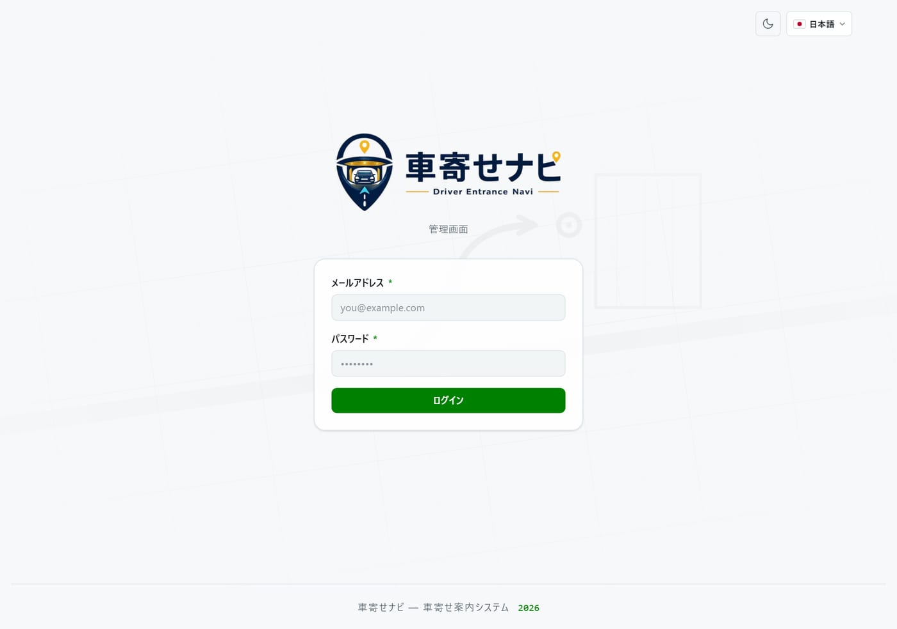
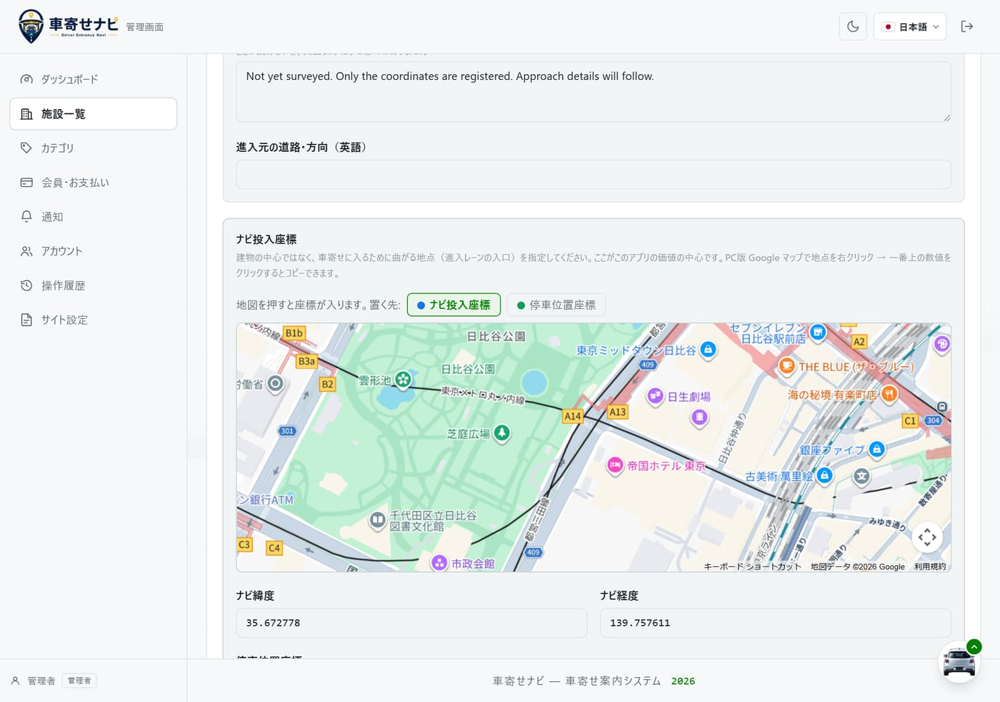
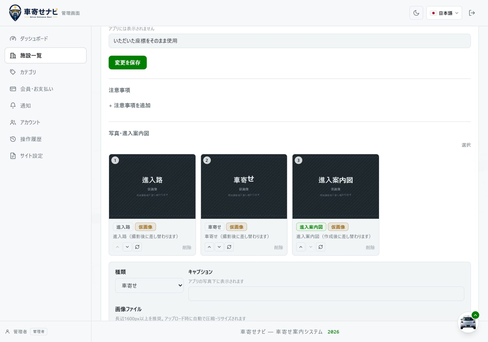
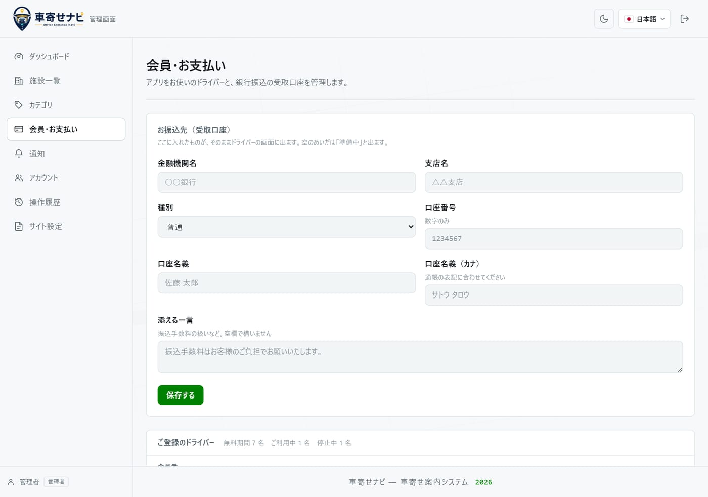
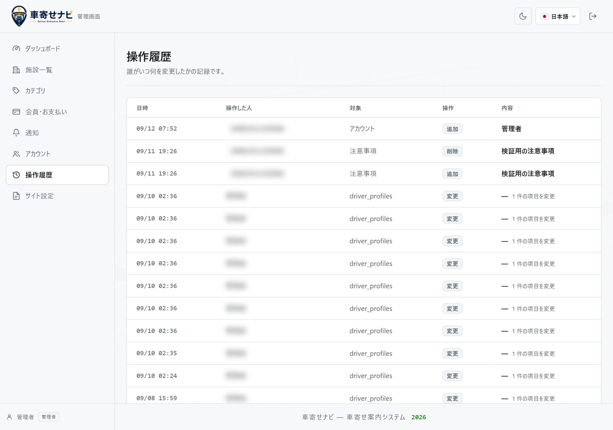

# 管理画面の使い方

車寄せナビの管理画面で行う操作を、画面ごとにまとめています。

  **開く場所** https://kurumayose-navi-admin.vercel.app

上から順に読む必要はありません。**やりたいことの章だけ**お読みください。

| やりたいこと | 章 |
|---|---|
| 施設を新しく登録したい | [3. 施設を登録する](#3-施設を登録する) |
| 車寄せの場所や進入方法を直したい | [4. 入口・車寄せを直す](#4-入口車寄せを直す) |
| 工事中などの注意を出したい | [5. 注意事項を出す](#5-注意事項を出す) |
| 写真を入れ替えたい | [6. 写真を入れ替える](#6-写真を入れ替える) |
| ドライバーの入金を確認したい | [8. 会員とお支払い](#8-会員とお支払い) |
| お知らせを送りたい | [9. お知らせを送る](#9-お知らせを送る) |
| スタッフのアカウントを作りたい | [10. アカウントを発行する](#10-アカウントを発行する) |
| ドライバーから届いた情報を確かめたい | [13. 情報提供を審査する](#13-情報提供を審査する) |
| チャットの書き込みを見張りたい | [14. チャットを見張る](#14-チャットを見張る) |

---

## 1. ログインする

メールアドレスとパスワードを入れて「ログイン」を押します。

**うまくいかないとき**

* パスワードをお忘れの場合、この画面からは再設定できません。**管理者の方に新しいパスワードを発行してもらってください**（[10章](#10-アカウントを発行する)）
* 「ご利用を停止しています」と出る場合、アカウントが停止されています。管理者の方にご確認ください

**右上の3つ**は、どの画面にも出ています。

| | |
|---|---|
| ☾ / ☀ | 画面の明るさを切り替えます |
| 🇯🇵 日本語 | 表示する言語を変えます |
| ⇥ | ログアウトします |

**行き先は左の柱**にあります。画面が狭いとき（スマートフォンなど）は、左上の三本線を押すと出てきます。

---

## 2. ダッシュボード

いまの全体の状態が出ます。**数を押すと、その一覧へ移ります。**

ここは見るだけの画面です。作業は左の柱から選んでください。

---

## 3. 施設を登録する

左の柱から **「施設一覧」** を選びます。

### 探す

上の欄に**施設名・かな・別名・住所**のいずれかを入れて「絞り込む」。
カテゴリと状態（公開中／下書き）でも絞れます。

### 新しく登録する

1. 右上の **「＋ 施設を新規登録」** を押します
2. 次の項目を入れます

| 項目 | 必須 | 備考 |
|---|---|---|
| 施設コード | ● | `HTL-0001` のような記号。重複はできません |
| 施設名 | ● | |
| よみがな | ● | **ドライバーはこれで探します。** 必ず入れてください |
| カテゴリ | ● | |
| 都道府県・市区町村・番地 | ● | |
| 別名 | | 「帝国ホテル」「インペリアル」など、呼ばれ方が複数あるとき |
| 概要 | | ひとことの説明 |

3. **「保存する」** を押します

登録した時点では **下書き** です。ドライバーのアプリにはまだ出ません。

### 公開する

施設の画面の上に「公開状態」の箱があります。**「公開する」** を押すと、ドライバーのアプリに出ます。

  公開の前に、足りないものがあれば箱の中に出ます。
  **「公開は可能ですが、確認をおすすめします」** は、公開しても構いません。
  **赤字で出るもの**は、直すまで公開できません。

一度公開したものを引っ込めるときは **「下書きに戻す」** を押します。

---

## 4. 入口・車寄せを直す

**この製品でいちばん大事なところです。** ドライバーはここを見て車を寄せます。

施設の画面を下へ送ると「入口・車寄せ」があります。

### 追加する

右の **「＋ 入口・車寄せを追加」** を押すと、新しい箱が増えます。

| 項目 | 入れかた |
|---|---|
| **入口記号** | `A` `B` など。ドライバーの画面で丸の中に出ます |
| **区分** | 車寄せ／地下駐車場／降車専用 など |
| **名称** | 「車寄せ（進入路1）」「ガーデンテラス入口」など、現地の呼び方 |
| **進入方法の説明** | **ドライバーに話しかけるつもりで**書いてください |
| **どこから入るか** | 「六本木通りから」など |
| **案内の座標** | 下の地図で位置を決めます |
| **高さ制限** | cm。ハイエースなどで引っかかる場所は必ず |
| **屋根あり／24時間** | 当てはまれば入れてください |

### 座標の決めかた

地図の上をクリックすると、その場所が座標になります。

  **建物の中心ではなく、進入レーンの入口**に置いてください。
  一般の地図アプリは建物の中心を案内するため、車寄せまで数十メートル
  ずれます。**そのずれを無くすことが、この製品の目的です。**

  地図は右上で **「地図＋写真」** に切り替えられます。建物の形と
  車寄せの位置は、線の地図より航空写真のほうが読み取れます。

  **同じ施設のほかの入口は、灰色のピン（A・B など）で出ます。**
  2つの入口が同じ道に重なっていないかを、ここで確かめられます。
  灰色のピンは見るためだけのもので、動きません。

### 入口が2つ以上ある施設

「入口・車寄せ」のすぐ下に **「入口の位置」** の地図が出ます。
ドライバーの画面と同じく、入口ごとにピン（A・B）が立ちます。

  * **ピンを押すと**、その入口の箱へ移ります
  * 各入口の見出しの **「地図で見る」** で、この地図のそのピンへ戻ります
  * 薄いピンは、無効にしている入口です（ドライバーには出ません）

  ドライバーの画面では、ピンか入口の箱を押すと、**「経路」の行き先が
  その入口に変わります**（「経路（B）」のように出ます）。

### 並び順

箱を上下に動かすと、ドライバーの画面での並びが変わります。
**いちばん上が「おすすめ」として出ます。**

### 消す

箱の右上の「この入口を削除」。確認が出ます。

---

## 5. 注意事項を出す

工事中・催事・夜間の動線変更など、**いま現地で効いている条件**を伝えます。

施設の画面の「注意事項」から追加します。

| 項目 | 入れかた |
|---|---|
| 本文 | 「正面は工事中です。北側からお回りください」など |
| 重さ | 情報／注意／重要 |
| 期間 | いつからいつまで |
| 曜日・時間帯 | 「平日 07:00–09:00」のような条件を付けられます |

  **条件を付けたものは、その時間帯だけドライバーの画面に出ます。**
  期間を過ぎたものは自動で出なくなります。消す必要はありません。

  ドライバーの「お知らせ」にも、いま効いている注意が並びます。

---

## 6. 写真を入れ替える

入口ごとに写真を持てます。

1. 入口の箱の **「写真・進入案内図」** を開きます
2. **種類**（車寄せ／進入路／案内図など）と、必要なら**キャプション**を入れます
3. **画像ファイル**を選びます。**枠に画像を落としても選べます**
4. **「写真を追加」** を押します

  長辺1600px以上を推奨。**送るときに自動で圧縮・縮小されます。**
  携帯で撮ったままの大きさで構いません。

**並び替え・差し替え・削除**

* 並び替えは各写真の **「前へ移動」「後ろへ移動」**。**いちばん上が代表**です
* **「画像を差し替える」** … 種別・説明・順番はそのままで、絵だけ入れ替えます
* 削除は各写真の削除ボタンから

**ファイル名は気にしなくて構いません。**

  撮影時のファイル名のままで結構です。まとめてお送りいただく場合の
  決まりは `docs/05-photo-guide.md` にあります（施設名／進入口名の
  フォルダに入れていただくだけです）。

**仮画像について**

  現地調査の前は「進入案内図（作成後に差し替わります）」という仮の
  画像が入っています。**仮のままでも公開できます。** 文章と座標が
  正しければ、ドライバーには既に十分な価値があります。

---

## 7. カテゴリ

ドライバーの「カテゴリから探す」に並ぶ札です。

* **追加** … 名前・識別子・接頭辞を入れて追加します。接頭辞は施設コードの頭（`HTL-` など）になります
* **並べ替え** … 表示順を変えると、ドライバーの画面でもこの順に出ます
* **有効／無効** … 「アプリに表示する」を外すと、ドライバーの画面から消えます（**中の施設は消えません**）
* **削除** … **施設が1件でも紐づいていると削除できません。** 一覧から隠したいだけなら「無効」にしてください

  いまは**ホテル以外が0件**です。施設を登録すると、そのカテゴリの札から
  たどれるようになります。

---

## 8. 会員とお支払い

### 受取口座を入れる

上の「お振込先（受取口座）」に入れたものが、**そのままドライバーの画面に出ます。**

  **打ち間違いは、そのまま宛先違いの振込になります。**
  欄の並びは通帳の並び（金融機関 → 支店 → 種別 → 番号 → 名義）です。
  通帳を見ながら写してください。

  空のあいだ、ドライバーの画面には「準備中」と出ます。

### 入金を確認する

下に、ご登録のドライバーが並びます。

**並びは「手を打つ必要がある順」です。** 会員番号順ではありません。

  期限切れ → 無料期間（期限の近い順）→ ご利用中 → 停止中

| 列 | 見かた |
|---|---|
| 会員番号 | **振込名義に添えていただく番号**です。通帳と突き合わせます |
| メールアドレス | 押すと、その方へのメールが開きます |
| 状態 | 無料期間／ご利用中／期限切れ／停止中 |
| ご利用期間の終わり | 無料期間、またはお支払いいただいた期間の終わり。「あと◯日」「◯日超過」が添えられます |
| ご希望の料金 | 1か月／3か月／6か月／1年。ドライバーが選んだもの |

**通帳で入金を確認したら**、その行の **「入金を確認した」** を押します。
状態が「ご利用中」に変わり、**ドライバーはすぐ使えるようになります。**

  押し間違えたときは「無料期間へ戻す」で戻せます。

**いつまでご利用いただけるかは、そのときに決まります。**
お選びの料金ぶんだけ先の日付が入ります（1か月をお選びなら1か月先）。
期限より前にお振込みいただいた場合は、**残りの日数に足します。**
**無料期間の残りも足します。** 無料期間の途中でお振込みいただいた方が、
残りを失わないようにしてあります。早く払った方ほど損をする、という
ことが起きません。

  例）無料期間があと27日残っている方が「1年」でお振込み
  　　→ 27日 ＋ 1年 が、その方のご利用期間になります。

残りは「あと11か月 20日」のように、月と日で出します。

  期間が過ぎると、無料期間が終わったときと同じように、
  その方は設定より先へ進めなくなります。一覧では「期限切れ」として
  いちばん上に並びます。次のお振込みを確認したら、また
  「入金を確認した」を押してください。

  **「期限なし」と出ている方**は、この仕組みを入れる前から
  ご利用中だった方です。期限を勝手に決めると、お支払い済みの方を
  突然締めることになるため、そのままにしてあります。次に
  「入金を確認した」を押した時点で期限が入ります。

### 「無料（調査員）」「無料（運営者）」と出ている方

アプリを無料で使える方です。期限も入金の確認もありません
（「入金を確認した」の釦は出ません）。

* **無料（調査員）** … 調査員のアカウントでアプリに入った方。調査員を停止すると、
  通常の会員と同じ扱いに戻ります
* **無料（運営者）** … 所有者のアカウント（aprofessional0575@gmail.com）と、
  上野修さんのアカウント（osa603mu@yahoo.co.jp）。試験提供の期間が終わっても
  無料のままです。情報提供の順位（翌月無料）には入りません

### 利用を停止する

**「利用を停止」** を押すと、その方はログインしても中へ入れなくなります。
解くときは「停止を解く」。

  停止はいつでも解けます。**退会とは違い、データは残ります。**

### 無料期間が終わったら

無料期間が終わり、入金の確認が済んでいない方は、**設定の画面より先へ進めません。**
施設の検索は使えなくなります。お支払いの手続きと、こちらへの連絡はできます。

  終わる **2日前と1日前**に、ドライバーの「お知らせ」へ自動で出ます。
  こちらでの操作は要りません。

---

## 9. お知らせを送る

**アプリを開いていなくても、端末に届く知らせ**を送ります。

1. **件名**を入れます（必須）
2. **本文**は120文字以内。端末側で切り詰められるため、短く
3. **押したときに開く画面**は空欄で構いません（「お知らせ」が開きます）
4. **「送る」** を押します

  **押した時点で鳴ります。取り消しはできません。**
  「届く先」に、いま受け取れる端末の数が出ています。0台なら誰にも届きません。

**受け取れるのは、ドライバーがマイページで「お知らせの通知」を入れた端末だけ**です。
iPhone は**ホーム画面へ追加した場合のみ**受け取れます。

**「配信の鍵」**は作成済みです。作り直すと、いま受け取っている端末が**すべて受け取れなくなります。**

---

## 10. アカウントを発行する

スタッフのアカウントを作り、権限を決めます。**管理者だけが開けます。**

1. お名前・メールアドレスを入れます
2. **役割**を選びます

| 役割 | できること |
|---|---|
| **管理者** | すべて。会員・お支払い・通知・アカウント・操作履歴も |
| **編集者** | 施設・カテゴリ・写真の登録と編集。公開もできます |
| **調査員** | **下書きの登録・編集のみ。** 公開済みの情報は変更できません |

3. **「発行する」** を押します

  発行すると、**仮のパスワードが画面に出ます。** その場で控えて、
  ご本人へお伝えください。**この画面を閉じると二度と出ません。**

**パスワードを忘れた方がいたら**、その行から新しい仮パスワードを発行できます。

**調査員はアプリを無料で使えます。** 発行したメールアドレスとパスワードで、
ドライバー向けのアプリにもそのまま入れます。無料期間が過ぎても締め出されず、
お支払いの手続きも出ません。別に登録する必要はありません。

**停止する／削除する**

* **停止する** … ログインできなくなります。いつでも解けます。調査員の場合、
  アプリの無料も外れます
* **削除する** … 元に戻せません。**操作履歴には名前が残ります**

  所有者のアカウントは操作できません。

---

## 11. 操作履歴

**誰がいつ何を直したか**が残ります。管理者だけが見られます。

消えた情報を探すとき、直した覚えのない変更があったときに使います。
ここから元へ戻すことはできません。

---

## 12. サイト設定

アプリの「このアプリについて」に出る、**掲載先と連絡先**です。

| 項目 | 用途 |
|---|---|
| 運営者名 | 特定商取引法に基づく表記に使うお名前 |
| お問い合わせ先（メール） | ドライバーが押すと、この宛先へのメールが開きます |
| 利用規約のURL | |
| プライバシーポリシーのURL | |
| 特定商取引法に基づく表記のURL | |

**入れた項目だけがアプリに出ます。** 空のままの項目は出ません。

  **お金を受け取る前に、この4つが要ります。** 文面の雛形は
  `docs/13-legal-templates.md` にあります。ホームページ等に掲載し、
  そのURLをここへ貼り付けてください。

  **利用規約かプライバシーポリシーのURLを入れると、アプリの登録の画面に
  「利用規約とプライバシーポリシーに同意する」の欄が出ます。** 印を付けないと
  登録できません。同意した日時と、そのときのURLは、会員ごとに記録されます。
  URLが空のあいだは、この欄は出ません（読めない規約に同意を求めないため）。

### 圏外で使える日数

同じ画面のいちばん下にあります（1〜365日、**既定は30日**）。

電波の届かない場所（地下駐車場など）では、アプリは**最後にサーバーで
確かめた会員の情報**で動きます。確かめてからこの日数を過ぎると、アプリは
「電波の届く場所で開いてください」と出して止まります。電波が戻れば、
ドライバーが何も打たなくても、自動で確かめて使えるようになります。

| こんなとき | どうなるか |
|---|---|
| 毎日お使いの方 | そのあいだに必ず一度は電波のある場所で開くため、まず当たりません |
| 利用を停止した方・別の端末へ移った方 | 圏外のままでも、**この日数を過ぎれば使えなくなります**（電波のある場所で開けば、その時点ですぐ止まります） |
| 無料期間・お支払いの期間が切れた方 | 日数に関係なく、圏外でも止まります（期限の日付は端末が覚えています） |

  **短くしすぎると**、長く電波の届かない現場が続く方が、仕事の途中で
  止まることがあります。**長くしすぎると**、停止した方が圏外のまま
  使い続けられる期間が延びます。特にご事情がなければ、30日のままで
  お使いください。

### 試験提供の期間

**印が入っているあいだは、すべての会員が無料で使えます。** 登録から1か月の
無料期間が過ぎた方も、締め出されずに使い続けられます（利用規約 第4条第6項）。
いまは印が入っています。

| | アプリの見え方 |
|---|---|
| 無料期間の途中の方 | これまでどおり「無料期間 残り◯日」 |
| 無料期間が過ぎた方 | 「試験提供の期間中のため、無料でお使いいただけます」。料金の選択は出ません |
| 利用を停止した方 | 停止のまま（試験提供の期間中でも使えません） |

会員の一覧では、無料期間が過ぎた方は「期限切れ」と出ますが、一覧の上に
「試験提供の期間中のため、すべての会員が無料で使えています」と添えて
います。期限の日付は、有料での提供を始めたあとに効きます。

**有料での提供を始めるときに、印を外して保存します。** **外す30日前までに、
会員へお知らせしてください**（利用規約 第4条第4項）。

外すと、その時点で次のようになります（利用規約 第4条第7項）。

| | 外したあと |
|---|---|
| 無料期間（登録から1か月）を過ぎている方 | **その日から1か月の無料期間が付きます。** その1か月が過ぎると、お支払いが済むまで設定などの画面にしか入れなくなります |
| 無料期間の途中の方 | 残りの日数のままです |
| お支払い済みの方・調査員・運営者 | 変わりません |

保存すると「試験提供を終えました。無料期間を過ぎていた ◯ 名に、今日から
1か月の無料期間を付けました」と出ます。操作履歴にも、外した方と人数が
残ります。外したあとも、印を入れ直せば試験提供の期間中に戻ります（付いた
1か月はそのまま。もう一度外しても、二度は付きません）。

### 情報提供の上位の翌月無料

毎月の上位を何名まで、何件以上で翌月無料にするかです（既定は **20名・
3件以上**）。変えた値は、次に締める月から効きます。くわしくは
[13. 情報提供を審査する](#13-情報提供を審査する)をご覧ください。

---

## 13. 情報提供を審査する

ドライバーは、アプリの施設の画面から **「現地と違うところがあれば、
情報を送る」** で、入口の位置の違い・新しい入口・写真・注意事項などを
送れます。届いた情報は、左の **「情報提供」** に並びます。
審査待ちの数が、項目の右に出ます。

  **開けるのは管理者と編集者です。** 調査員には出ません。

### 採用・不採用を決める

1. 「審査待ち」の一覧を開きます（古いものから並びます）
2. 内容・写真・位置（「送ったときの位置を地図で見る」）を確かめます
3. **「採用」** か **「不採用」** を押します。覚え書きを添えられます
   （ドライバーには見えません）

  **採用しても、施設の情報は自動では変わりません。** 正しい内容だった
  場合は、これまでどおり施設の画面で入口・注意事項・写真を直してください。

  **件数に数えるのは「採用」だけです。** 採用した日がその月の件数に
  なります。

### 毎月の上位は、翌月無料になります

月が替わると、前の月の採用件数で順位を出し、**上位20名（3件以上）**の
ドライバーの翌月を無料にします。お支払い済みの方は、ご利用期間が1か月
延びます。人数と件数は「サイト設定」で変えられます（次に締める月から
効きます）。

  締めるのは、月が替わってから最初にだれかがアプリか管理画面を開いた
  ときです。何度開いても1回だけです。結果は「情報提供」の画面の上の
  **「毎月の上位（翌月無料）」**に出ます。会員の一覧では「無料（上位）」と
  出ます。

  **月末までに審査を済ませてください。** 翌月に入ってから採用したものは、
  翌月の件数になります。

  押し間違えたときは、「採用」「不採用」の一覧から **「審査待ちに戻す」**
  で戻せます。審査の記録は操作履歴に残ります。

  送られた写真は、ドライバー本人と管理者・編集者しか見られない場所に
  あります。施設に載せる場合は、施設の画面で写真として入れ直してください。

---

## 14. チャットを見張る

ドライバーは、アプリの **「チャット」→「情報交換」** で、ほかのドライバーと
書き込みを交わせます（全員に見える掲示板の形です。1対1のやりとりはありません）。
左の **「チャット」** に、未対応の通報と要確認（自動の旗）を足した数が出ます。

  **開けるのは管理者と編集者です。** 調査員には出ません。

* **通報（未対応）** … ドライバーから通報のあった書き込みです。件数と理由が出ます。
  **誰が通報したかは出ません**
* **要確認（自動の旗）** … 電話番号・メールアドレス・URL・車の番号らしきもの・
  気をつける言葉を含む書き込みです（古い順）。何が引っかかったかが添えてあります。
  旗が立っても、書き込みは止まりません（ドライバーには見えています）
* **未確認** … まだだれも確認していない書き込みです（古い順に100件ずつ）。
  読み終えたら、いちばん下の **「ここまで確認した」** を押します。
  **ほかの職員の画面からも消えます**（同じ書き込みを何人もが読まずに済みます）
* **すべての書き込み** … 新しい順に50件。非表示にしたものも出ます

  **毎日の見張りは「要確認」と「未確認」だけで足ります。** ドライバーが増えても、
  見るのは新しく来た分と、旗の立った分だけです。

  **画面を開いたままで、新しいものが自動的に出ます。** 書き込みは数秒で、
  通報は20秒ほどで出ます（読み直しのボタンを押す必要はありません）。

### ルールに反する書き込みがあったら

* **「非表示にする」** … ドライバーには見えなくなります。消えはせず、この画面と
  操作履歴に残ります。その書き込みの通報も片付きます。「表示に戻す」で戻せます
* **「問題なし（通報を片付ける）」** … 書き込みはそのままで、通報だけを片付けます
* **「問題なし（旗を下ろす）」** … 書き込みはそのままで、「要確認」から外します
  （誰がいつ下ろしたかは記録されます）
* **「この会員の書き込みを止める」** … その方は書き込めなくなります。アプリは
  使えるまま、読むこともできます。「書き込みの停止をやめる」で戻せます

  1人あたり1分に5件、1日に100件までに抑えてあります（連投の防止）。

### 気をつける言葉を変える

**「サイト設定」→「チャットの気をつける言葉」** に、1行に1つずつ書きます
（200語まで）。書き込みにその言葉が含まれると「要確認」に出ます。初めは悪口や
勧誘によくある言葉を入れてあります。電話番号・メールアドレス・URL・車の番号
らしきものは、ここに書かなくても自動で拾います。変えた言葉は、そのあとの
書き込みから効きます。

### 90日を過ぎた書き込み

**ドライバーの画面からは、書き込んだ日から90日で外れます。** アプリは直近10日ぶんを
出し、上へスクロールすると前の分を読み足します（90日まで）。**この管理画面では、
90日を過ぎた書き込みも見られます**（見張りと記録のため。消してはいません）。

  アプリの情報交換では、アプリを開いている方のアイコンに緑の丸（オンライン）、
  そうでない方に灰色の輪（オフライン）が付きます。**オンラインかどうかは記録しないため、管理画面では見られません。**
  ドライバーは設定の「チャットでオンライン状態を出さない」で隠せます。

---

## 困ったときに

| 症状 | 見るところ |
|---|---|
| ドライバーの画面に施設が出ない | 施設が**下書き**のままではありませんか（[3章](#3-施設を登録する)） |
| 直したのにアプリに反映されない | ドライバーのアプリは端末に控えを持ちます。**マイページの「施設情報の取り込み」で取り直せます。** |
| ドライバーがログインできない | アカウントを**停止**していませんか（[8章](#8-会員とお支払い)） |
| 通知が届かない | 「届く先」が0台ではありませんか（[9章](#9-お知らせを送る)） |
| 削除したものを戻したい | **戻せません。** 操作履歴で内容だけは確認できます（[11章](#11-操作履歴)） |

<!-- pdf-skip:start -->

---

  **ここから下は、お渡しする PDF には入りません。**
  この文書の画面写真は 2026年9月12日 時点のものです。
  画面を変えたときは、`docs/images/admin/` の画像も撮り直し、
  `node tools/build-manual-pdf.mjs` で PDF を作り直してください。

<!-- pdf-skip:end -->
